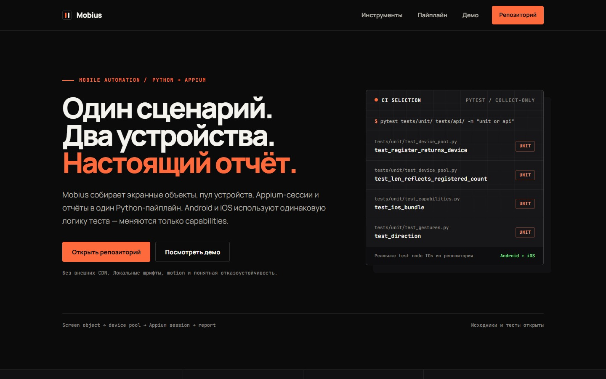
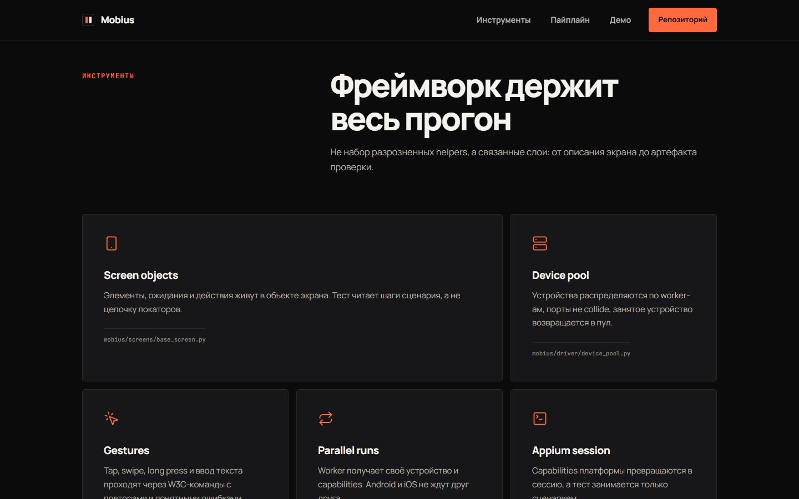
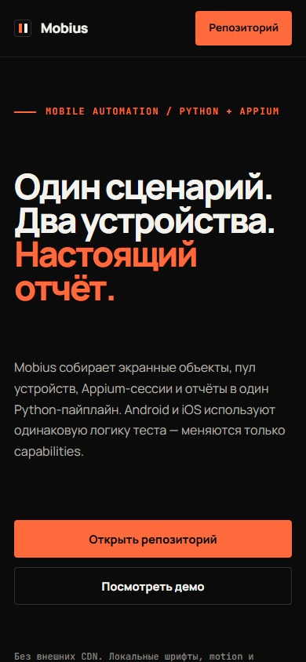

# Mobius


  <a href="https://github.com/ssrjkk/mobius/actions/workflows/ci.yml">
    
  </a>
  <a href="https://www.python.org/downloads/">
    
  </a>
  <a href="https://appium.io/">
    
  </a>
  <a href="README.ru.md">
    
  </a>


Mobile test automation for Android and iOS built on Appium 2.x and pytest. Provides screen objects, device pooling, gesture helpers, and CI-ready infrastructure for parallel test execution.

**Site:** https://ssrjkk.github.io/mobius/

## Screenshots

Captured from the published site in a real browser (Chrome, 1440×900 and 390×844).

| Home | Sections |
| --- | --- |
|  |  |

<p align="center"></p>

## Quick Start

```bash
# Clone and install
git clone git@github.com:ssrjkk/mobius.git
cd mobius
pip install -e ".[test]"

# Run tests (no device required)
make test-all

# Check code quality
make lint
```

## What's Inside

- **951 tests** — unit + API in the CI pipeline, ~2 minutes without an emulator; wire-protocol, contract and UI groups run locally (UI needs a live Appium server)
- **99% code coverage** — 98.58% measured on the CI run, enforced at 80% minimum
- **Strict typing** — mypy + ruff linting
- **Security scanning** — bandit SAST + pip-audit for dependency CVEs
- **Parallel execution** — pytest-xdist + DevicePool for multi-device testing
- **Allure reports** — automatic in CI with screenshot on failure

## Project Structure

```text
mobius/
├── driver/          Appium driver, capabilities, device pool
├── elements/        MobileElement with auto-retry on StaleElement
├── screens/         Screen Object Pattern base classes
└── utils/           24+ modules: gestures, network, biometrics, interruptions, ...

tests/
├── unit/            567 tests (mocked driver)
├── api/             Backend API tests (respx mocking)
├── wire_protocol/   Real HTTP via fake WebDriver server
└── ui/              E2E tests (requires Appium + device)
```

## Features

### Parallel Testing on Multiple Devices

```python
pool = DevicePool()
pool.register("emulator-5554", Platform.ANDROID, "13.0", "Pixel 6")
pool.register("emulator-5556", Platform.ANDROID, "14.0", "Pixel 7")
pool.assert_no_port_collisions()

device = pool.get_for_worker(os.environ.get("PYTEST_XDIST_WORKER"))
```

### Test Isolation

```python
@pytest.fixture(autouse=True)
def auto_reset(driver):
    AppResetHelper(driver, "com.example.app").reset(ResetStrategy.TERMINATE)
```

### Element Finding Without Screen Objects

```python
finder = UniversalFinder(driver)
finder.find_button_by_text("Sign In").click()
finder.screen_contains_text("Welcome")
```

### YAML-Driven Configuration

```python
config = AppConfig.load("apps/my_app.yaml")
driver = create_driver(config.to_capabilities())
screen = ConfigDrivenScreen(driver, config)
screen.tap("login_button")
```

### Screen Objects with Auto-Retry

```python
class LoginScreen(BaseScreen):
    _USERNAME = (AppiumBy.ACCESSIBILITY_ID, "Username input field")
    _LOGIN_BTN = (AppiumBy.ACCESSIBILITY_ID, "Login button")

    def login(self, user: str, password: str) -> None:
        self.type_text(self._USERNAME, user)
        self.tap(self._LOGIN_BTN)
```

## Example Test

```python
import pytest
from mobius import create_driver, DeviceCapabilities, Platform
from mobius.screens.login_screen import LoginScreen

@pytest.fixture
def driver():
    caps = DeviceCapabilities(
        platform=Platform.ANDROID,
        platform_version="14.0",
        device_name="Pixel 6",
        app="com.example.app",
    )
    driver = create_driver(caps.to_capabilities())
    yield driver
    driver.quit()

def test_login(driver):
    screen = LoginScreen(driver)
    screen.login("user@example.com", "password123")
    assert screen.is_logged_in()
```

## Commands

```bash
pip install -e ".[test]"
```

| Command | Description |
| :--- | :--- |
| `make test-all` | Unit + API + wire protocol (no device needed) |
| `make test-parallel` | Same, but in 4 threads |
| `make test-ui` | E2E UI tests (requires Appium + device) |
| `make lint` | ruff + mypy |
| `make security` | bandit + pip-audit |
| `make ci` | lint + test-all + security |

## Documentation

- **[USAGE.md](docs/USAGE.md)** — detailed usage guide with examples
- **[README.ru.md](README.ru.md)** — русская версия
- **[CONTRIBUTING.md](CONTRIBUTING.md)** — contribution guidelines
- **[SECURITY.md](SECURITY.md)** — security policy
- **[LICENSE](LICENSE)** — MIT
- [Changelog](CHANGELOG.md)
- [Showcase](https://ssrjkk.github.io/mobius/showcase/)

## Author

**Sergey Sitnikov**
GitHub: [@ssrjkk](https://github.com/ssrjkk)


## Installation

```bash
git clone https://github.com/ssrjkk/mobius.git
cd mobius
pip install -r requirements.txt
```

## Usage

```bash
python main.py
```

---

**SSRJKK** — [GitHub](https://github.com/ssrjkk) · [Telegram](https://t.me/ssrjkk) · [Projects hub](https://ssrjkk.github.io/) · [Bot catalogue](https://t.me/ssrjkk_bot)
