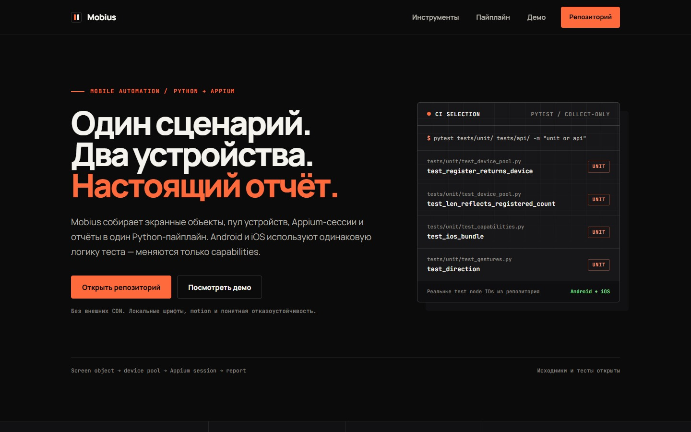
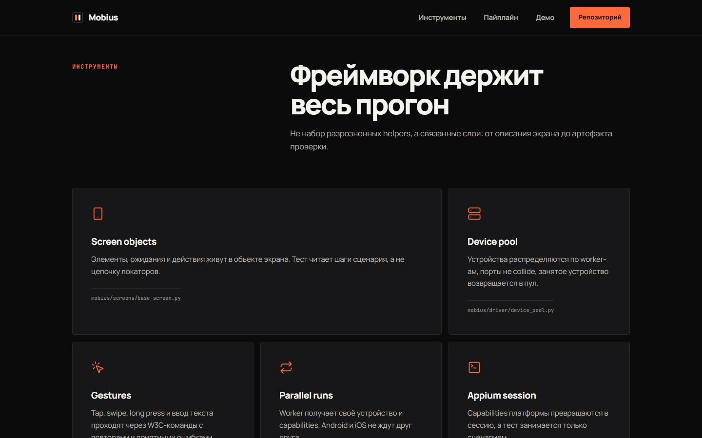
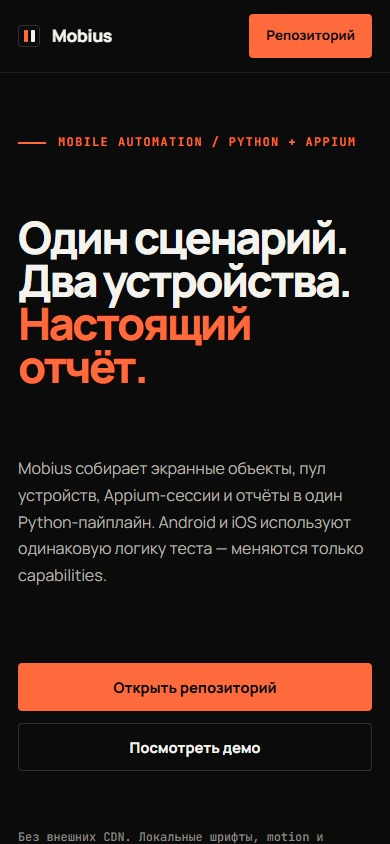

# Mobius

<p align="center">
  <a href="https://github.com/ssrjkk/mobius/actions/workflows/ci.yml">
    
  </a>
  <a href="https://www.python.org/downloads/">
    
  </a>
  <a href="https://appium.io/">
    
  </a>
  <a href="README.md">
    
  </a>
</p>

Автоматизация мобильных тестов для Android и iOS на базе Appium 2.x и pytest. Screen objects, пул устройств, хелперы жестов и CI-инфраструктура для параллельного запуска тестов.

**Сайт:** https://ssrjkk.github.io/mobius/

## Скриншоты

Сняты с опубликованного сайта в настоящем браузере (Chrome, 1440×900 и 390×844).

| Главная | Разделы |
| --- | --- |
|  |  |

<p align="center"></p>

## Быстрый старт

```bash
# Клонировать и установить
git clone git@github.com:ssrjkk/mobius.git
cd mobius
pip install -e ".[test]"

# Запустить тесты (без устройства)
make test-all

# Проверить код
make lint
```

## Что внутри

- **950 тестов** — unit + API в CI-пайплайне, ~2 минуты без эмулятора; wire-protocol, contract и UI группы идут локально (UI нужен живой Appium-сервер)
- **99% покрытия кода** — замер 98.58% на CI-прогоне, минимум 80% enforced
- **Строгая типизация** — mypy + ruff
- **Security scanning** — bandit SAST + pip-audit на CVE в зависимостях
- **Параллельный запуск** — pytest-xdist + DevicePool для мульти-девайс тестов
- **Allure-отчёты** — автоматически в CI со скриншотами на падении

## Структура проекта

```text
mobius/
├── driver/          Appium драйвер, капабилити, пул устройств
├── elements/        MobileElement с авто-retry при StaleElement
├── screens/         Базовые классы Screen Object Pattern
└── utils/           24+ модуля: жесты, сеть, биометрия, прерывания, ...

tests/
├── unit/            567 тестов (мок драйвера)
├── api/             API тесты (respx моки)
├── wire_protocol/   Реальный HTTP через фейковый WebDriver сервер
└── ui/              E2E тесты (нужен Appium + устройство)
```

## Возможности

### Параллельный запуск на нескольких устройствах

```python
pool = DevicePool()
pool.register("emulator-5554", Platform.ANDROID, "13.0", "Pixel 6")
pool.register("emulator-5556", Platform.ANDROID, "14.0", "Pixel 7")
pool.assert_no_port_collisions()

device = pool.get_for_worker(os.environ.get("PYTEST_XDIST_WORKER"))
```

### Изоляция тестов

```python
@pytest.fixture(autouse=True)
def auto_reset(driver):
    AppResetHelper(driver, "com.example.app").reset(ResetStrategy.TERMINATE)
```

### Поиск элементов без Screen Objects

```python
finder = UniversalFinder(driver)
finder.find_button_by_text("Sign In").click()
finder.screen_contains_text("Welcome")
```

### Конфигурация через YAML

```python
config = AppConfig.load("apps/my_app.yaml")
driver = create_driver(config.to_capabilities())
screen = ConfigDrivenScreen(driver, config)
screen.tap("login_button")
```

### Screen Objects с авто-retry

```python
class LoginScreen(BaseScreen):
    _USERNAME = (AppiumBy.ACCESSIBILITY_ID, "Username input field")
    _LOGIN_BTN = (AppiumBy.ACCESSIBILITY_ID, "Login button")

    def login(self, user: str, password: str) -> None:
        self.type_text(self._USERNAME, user)
        self.tap(self._LOGIN_BTN)
```

## Пример теста

```python
import pytest
from mobius import create_driver, DeviceCapabilities, Platform
from mobius.screens.login_screen import LoginScreen

@pytest.fixture
def driver():
    caps = DeviceCapabilities(
        platform=Platform.ANDROID,
        platform_version="14.0",
        device_name="Pixel 6",
        app="com.example.app",
    )
    driver = create_driver(caps.to_capabilities())
    yield driver
    driver.quit()

def test_login(driver):
    screen = LoginScreen(driver)
    screen.login("user@example.com", "password123")
    assert screen.is_logged_in()
```

## Команды

```bash
pip install -e ".[test]"
```

| Команда | Описание |
| :--- | :--- |
| `make test-all` | Unit + API + wire protocol (без устройства) |
| `make test-parallel` | То же в 4 потока |
| `make test-ui` | E2E UI тесты (нужен Appium + устройство) |
| `make lint` | ruff + mypy |
| `make security` | bandit + pip-audit |
| `make ci` | lint + test-all + security |

## Документация

- **[USAGE.md](docs/USAGE.md)** — подробное руководство по использованию с примерами
- **[README.md](README.md)** — English version
- **[CONTRIBUTING.md](CONTRIBUTING.md)** — как контрибьютить
- **[SECURITY.md](SECURITY.md)** — политика безопасности
- **[LICENSE](LICENSE)** — MIT
- [Changelog](CHANGELOG.md)
- [Showcase](https://ssrjkk.github.io/mobius/showcase/)

## Автор

**Sergey Sitnikov**
GitHub: [@ssrjkk](https://github.com/ssrjkk)
